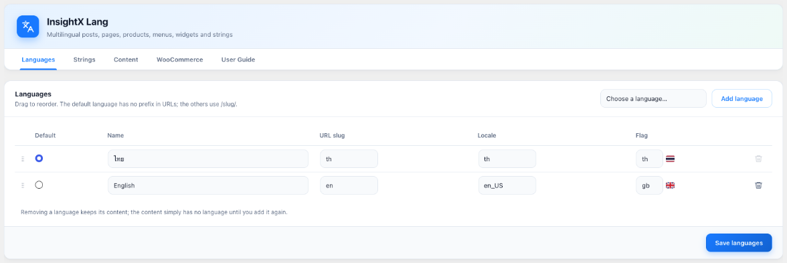
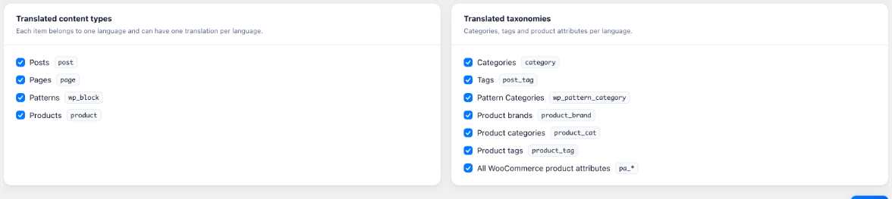
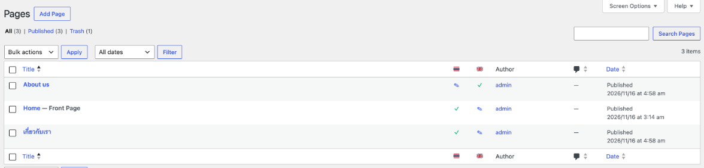
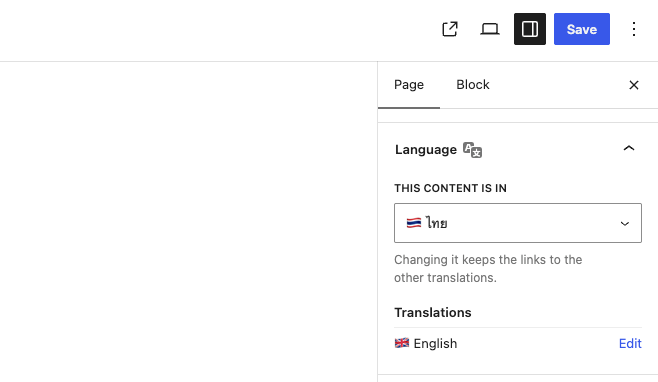
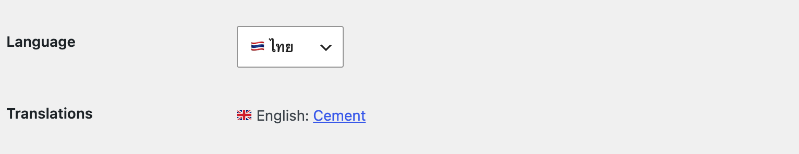
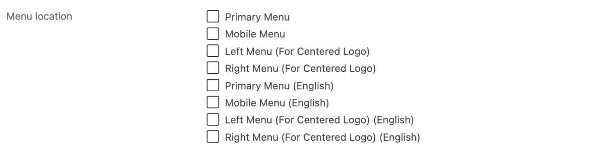
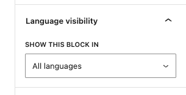
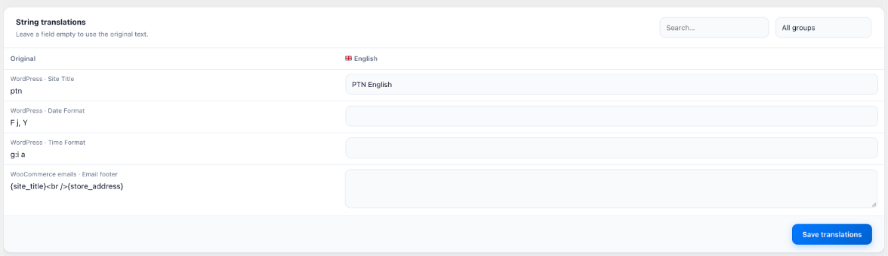
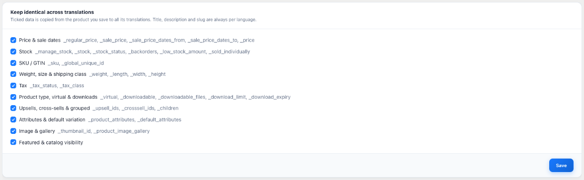

# คู่มือการใช้งาน InsightX Lang

คู่มือนี้ใช้ภาพหน้าจอจริงจากเว็บ PTN ในหน้า WordPress Admin ภาพบางภาพแสดงภาษาอังกฤษตามภาษาที่ผู้ดูแลเลือกไว้ ชื่อเมนูและตำแหน่งปุ่มอาจต่างกันเล็กน้อยเมื่อ WordPress ใช้ภาษาไทย

## 1. ตั้งค่าภาษา

1. ปิด Polylang และ Hyyan WooCommerce Polylang Integration ถ้าใช้งานอยู่ เพราะ InsightX Lang จะหยุดทำงานเมื่อพบปลั๊กอินเหล่านี้
2. ไปที่ **InsightX Lang → Settings → Languages** เลือกภาษาจากช่อง **Choose a language…** แล้วกด **Add language**
3. เลือกภาษาหลักที่คอลัมน์ **Default** ตรวจชื่อ, URL slug, locale และธง แล้วกด **Save languages**
4. ภาษาหลักใช้ URL ปกติ เช่น `/about/` ส่วนภาษาอื่นใช้ slug นำหน้า เช่น `/en/about/`

เมื่อบันทึกภาษาครั้งแรก ปลั๊กอินจะกำหนดเนื้อหาเดิมที่ยังไม่มีภาษาเป็นภาษาหลัก หากยังมีเนื้อหาที่ไม่ถูกกำหนดภาษา ให้ใช้ปุ่มจัดการเนื้อหาที่ไม่มีภาษาในแท็บนี้

## 2. เลือกประเภทเนื้อหาที่จะแปล

เปิดแท็บ **Content** แล้วเลือกประเภทเนื้อหาและ taxonomy ที่ต้องการแปล จากนั้นบันทึกค่า เริ่มจากหน้า, เรื่อง และสินค้าที่ใช้จริงก่อน เพื่อให้คอลัมน์ภาษาและปุ่มสร้างฉบับแปลแสดงเฉพาะจุดที่ต้องการ

## 3. สร้างฉบับแปลของหน้า เรื่อง และสินค้า

เปิดรายการเนื้อหาประเภทนั้น คอลัมน์ธงแสดงว่าภาษาใดมีฉบับแปลแล้ว กดเครื่องหมาย **+** ในภาษาปลายทางเพื่อสร้างฉบับร่างจากต้นฉบับ แล้วแปลชื่อ, เนื้อหา และ slug ก่อนเผยแพร่ เครื่องหมายดินสอใช้เปิดฉบับแปลที่มีอยู่

ใน Gutenberg ใช้แผง **Language** ที่ sidebar เพื่อตรวจภาษาของหน้าปัจจุบันและเปิดฉบับแปล หากมีการแก้ไขค้างอยู่ ให้บันทึกก่อนกดสร้างฉบับแปล เพื่อให้คัดลอกข้อมูลล่าสุด

**หน้าแรกภาษาอื่น:** แปลหน้าที่กำหนดเป็นหน้าแรกใน **ตั้งค่า → การอ่าน** และเผยแพร่ก่อน จึงเปิด URL เช่น `/en/` ได้

## 4. แปลหมวดหมู่ แท็ก และคุณสมบัติสินค้า

เปิดหน้าแก้ไข term เลือกภาษาของ term นั้น แล้วใช้ช่องฉบับแปลเพื่อผูก term ภาษาอื่นเข้าด้วยกัน สำหรับสินค้ามีตัวเลือก ควรแปลคุณสมบัติและค่าคุณสมบัติก่อนสร้างหรือแก้ฉบับแปลของสินค้า

## 5. ตั้งเมนูและตัวสลับภาษา

ไปที่ **หน้าตา → เมนู** สร้างเมนูแยกสำหรับแต่ละภาษา แล้วเลือกตำแหน่งเมนูที่ลงท้ายด้วยชื่อภาษานั้น เช่น **Primary Menu (English)** ใส่ลิงก์ไปยังหน้าของภาษาเดียวกัน

เพิ่มตัวสลับภาษาได้ด้วยบล็อก **Language Switcher**, shortcode `[isxl_switcher]` หรือรายการในเมนู เมื่อลิงก์ของฉบับแปลยังไม่มี ตัวสลับภาษาจะใช้ทางเลือกตามการตั้งค่าของปลั๊กอิน ตรวจผลบนหน้าเว็บจริงหลังเพิ่ม

## 6. แสดงบล็อกหรือวิดเจ็ตเฉพาะภาษา

เลือกบล็อกใน Gutenberg แล้วเปิดแผง **Language visibility** ที่แท็บ Block เลือกภาษาที่ให้บล็อกนั้นแสดง หากต้องการให้เห็นทุกภาษา ให้คงค่า **ทุกภาษา** ไว้ วิดเจ็ตมีตัวเลือกภาษาในลักษณะเดียวกัน

## 7. แปลข้อความของเว็บไซต์

เปิดแท็บ **Strings** กรอกคำแปลในคอลัมน์ของภาษาอื่น แล้วบันทึก ใช้กับข้อความที่ปลั๊กอินรวบรวมไว้ เช่น ชื่อเว็บ, คำโปรย และข้อความที่ลงทะเบียนผ่าน API ข้อความจาก Customizer ต้องเลือกรายการในส่วน **Theme texts** ก่อนจึงจะแปลในตารางได้

ข้อความที่ฝังอยู่ในโค้ดธีมหรือปลั๊กอินต้องอาศัยไฟล์แปล `.mo` ของภาษาเป้าหมาย หรือให้นักพัฒนาลงทะเบียนข้อความด้วย `isxl_register_string()`

## 8. ตั้งค่าร่วมของสินค้า WooCommerce

เปิดแท็บ **WooCommerce** แล้วเลือกกลุ่มข้อมูลที่ต้องการให้เหมือนกันทุกฉบับแปล เช่น ราคา, สต็อก, SKU, น้ำหนัก และภาษี จากนั้นบันทึก ชื่อสินค้า, รายละเอียด และ slug ยังคงแปลแยกกัน

ถ้าต้องการให้สต็อกลดพร้อมกันทุกภาษา ให้เปิดการจัดการสต็อกใน **WooCommerce → ตั้งค่า → สินค้า → คลังสินค้า** และเปิดตัวเลือกสต็อกในแท็บนี้ แปลหน้า Shop, Cart, Checkout และ My account เช่นเดียวกับหน้าทั่วไป

## ตรวจผลและแก้ปัญหาเบื้องต้น

- เปิดหน้าเดียวกันทั้ง URL ภาษาหลักและ URL ที่มี prefix เช่น `/en/about/` แล้วตรวจเมนู, ตัวสลับภาษา และเนื้อหา
- ถ้า `/en/` กลับไปหน้าแรกภาษาหลัก ให้ตรวจว่าหน้าแรกภาษาอังกฤษเผยแพร่แล้ว
- ถ้าไม่เห็นเนื้อหาเดิม ให้ตรวจว่ากำหนดภาษาให้เนื้อหานั้นแล้ว
- ถ้าสร้างฉบับแปลใน Gutenberg ไม่ได้ ให้บันทึกหน้าปัจจุบันก่อน
- หาก URL ไม่ทำงานหลังติดตั้ง ไปที่ **ตั้งค่า → ลิงก์ถาวร** แล้วกดบันทึกหนึ่งครั้ง

คู่มือแบบโต้ตอบพร้อมสารบัญอยู่ที่ **InsightX Lang → User Guide** ใน WordPress Admin
